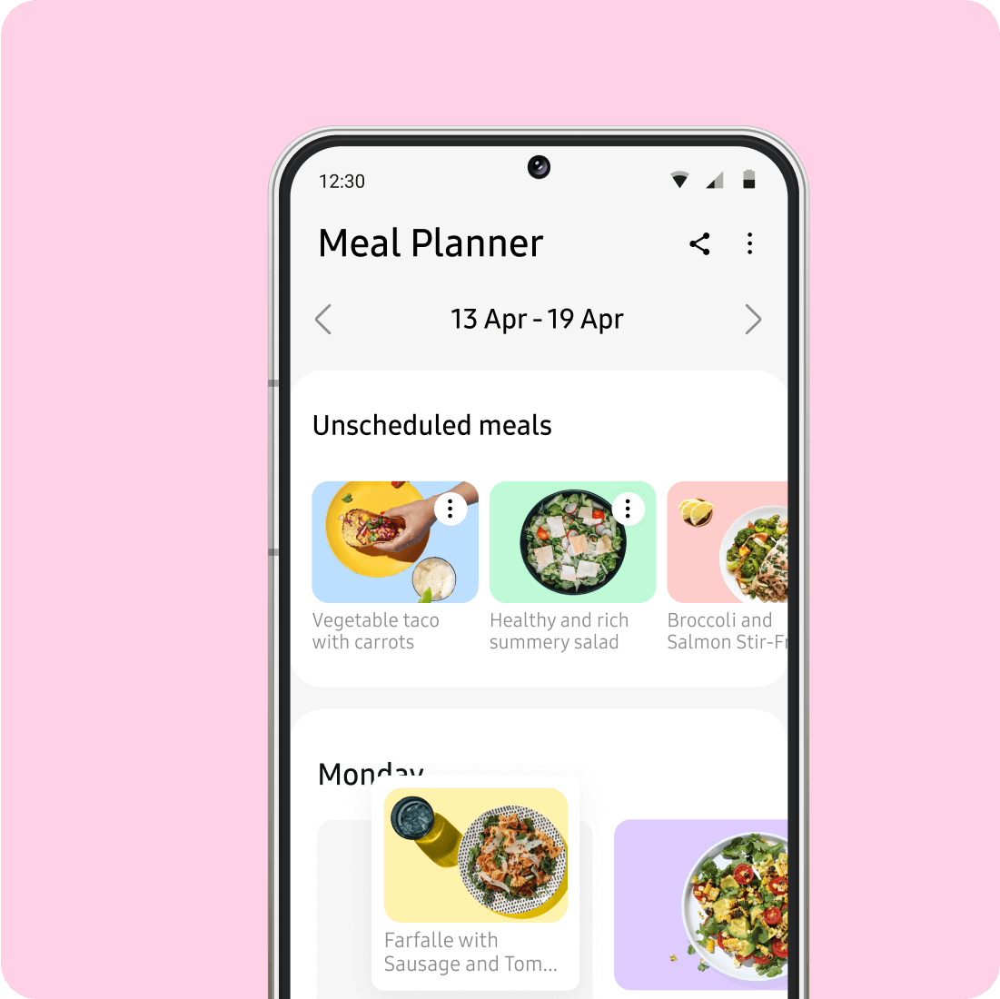

# Content
Topic: Cooking-How Technology is changing the Way people cook 

## Overview/Introduction/Context
* Over time, cooking has changed because of new technologies. People did not need cookbooks or traditional kitchens. 
* Technology makes cooking easier, helping people discover recipes, measure and keep track of cooking. 

## Part A: existing technology
1. Beginner-Friendly Cooking Apps

* Kitchen Stories
  * Website: https://www.kitchenstories.com/
  * Provides thousands of cooking and baking recipes.
  * Uses pictures and videos to demonstrate cooking techniques.
  * Gives users step-by-step cooking instructions.
  * Allows people to save recipes in their own digital cookbooks.
  * Helps people plan meals and create grocery lists.
  * Makes it easier for beginners to learn how to cook.

* SideChef
  * Website: https://www.sidechef.com/
  * App download: https://www.sidechef.com/download/
  * SideChef is a cooking app that helps people learn how to prepare meals through guided recipes and cooking instructions.
  * There are thousands of recipes with step by step directions.
  * You can shop for ingredients in the app.
  * This connects to software is kitchen hardware showing us how technology can make cooking much easier.
  * It includes built-in timers to help users keep track of cooking times.
  * Users can filter recipes by dietary preferences, ingredients, cuisine, and cooking time.
  * Some recipes include videos that demonstrate cooking techniques.
  * The app includes guided cooking with pictures that show users what to do at each step.

2. Recipe Discovery and Meal Planning
   
##### Software
* My first app that l found was Samsung food.
* Website: https://www.samsungfood.com/
  * Provides recipes for any kind of baking, desserts, breakfast, and dinner.
  * Share information about cooking methods, and ingredients.
  * People can search for recipes based on ingredients they already have at home
  * This helps people organize what they want to cook during the week.
  * The app provides nutrition information for many recipes.
  * People can save up to three meal plans with the free version.
  * Users can save up to three meal plans with the free version.
  * Samsung food is available on Android, IOS, Galaxy devices and the web.
  
 
 

 3. Advanced Cooking Software

* Crouton – Smart Recipe Organizer
 * Website: https://crouton.app/
 * Crouton is a digital cooking application that organizes recipes.
 * It can import recipes from websites.
 * It uses AI and image recognition technology to scan recipes from cookbook photographs.
 * It provides step-by-step cooking instructions.
 * It has a hands-free cooking mode that allows users to move between instructions without touching their device.
 * It automatically detects cooking times in recipes and creates timers.
 * It creates grocery lists from saved recipes.
 * It allows users to plan meals for the week.
 * It can sync recipes between supported Apple devices.
 * It can connect to compatible Bluetooth kitchen scales and temperature probes.

##### Hardware
* 1st hardware I looked into was the KitchenAid Intelligent Cooking Camera Oven
  * Website: https://www.kitchenaid.com/major-appliances/wall-ovens/oven-cooking-camera.html
  * This smart oven can recognize certain foods placed in the oven like cookies, chicken, pizza etc.
  * People can choose how they want certain foods cooked, such as softer or crispier.
  * The oven has a touchscreen display that allows users to select cooking settings and check the cooking progress.
  * Users can connect the oven to their phone to check on their food while they are away from the kitchen.
  * This is a hardware and software product because it is touchscreen and it has a camera. There is a Kitchenaid app to help control.
  * This app is available for IOS and Android.
  * it can create a time-lapse video of the entire cooking time-lapse video with other people.
  * Certain foods require a temperature probe to monitor their internal temperature.
  * The oven can begin cooking certain recognized foods without preheating first.
  * its camera features work with a 4.5-inch LCD touchscreen display.
  * Users can share their cooking time-lapse videos with other people. 
 
 
* 2nd hardware i looked into was Tovala Smart Oven
  * Website: https://www.tovala.com/smart-ovens
  * $299 but right now it is $69 for the Smart oven
  * $The Smart Oven Pro cost $349 but right now it is $119
  * The Tovala Smart Oven is a smart countertop oven that uses technology to make cooking easier and more convenient.
  * It combines several cooking appliances into one machine, including an oven, toaster, and air fryer.
  * It can automatically change cooking temperatures.
  * It can help people save time because they do not have to stress out about the cooking temperature and doing it themselves.
  * It connects to the internet using Wi-Fi
  * You can use it in a mobile app on IOS and Android.
  * Its built-in scanners can scan more than 1,000 name-brand grocery products.
  * After scanning a supported grocery barcode, the oven displays the cooking time.
  * Users can create their own custom cooking cycle through the app.
  * You can still use basic cooking modes like bake, broil and toast without WI-Fi.
 
* 3. DREO ChefMaker Combi Fryer
 *The DREO ChefMaker is a smart countertop cooking appliance.
 * It uses a special cooking probe to monitor food temperature.
 * It uses water atomization to help control moisture during cooking.
 * It combines convection heating with temperature sensors.
 * Its smart cooking system adjusts different cooking stages.
 * It has three cooking modes: Chef Mode, Classic Mode, and Probe Mode.
 * It connects to a mobile app with guided cooking recipes.
 * The app provides cooking instructions and progress updates.
 * It has a digital display for controlling cooking settings.
 * Its glass basket allows users to observe food while it cooks.

* 4. Thermomix TM7
  * Website: https://www.thermomix.com/
  * Combines more than 20 kitchen functions into one machine, including chopping, mixing, blending, and cooking.
  * Has a large 10-inch touchscreen that displays recipes and cooking instructions.
  * Uses the Cookidoo platform, which provides access to more than 100,000 recipes.
  * Has a built-in weighing scale that measures ingredients directly inside the machine.
  * Uses temperature sensors to help control heat while cooking.
  * Has a powerful motor that can chop, grind, mix, and knead ingredients.
  * Includes a steaming attachment called Varoma that allows people to steam vegetables, fish, and other foods.
  * Allows users to prepare multiple parts of a meal at the same time using its multi-layer cooking system.
  * Includes special cooking modes such as slow cooking, sous vide, fermentation, and steaming.
  * Connects to Wi-Fi to access recipes, receive software updates, and improve its cooking features.

## Part B: possible future technology

